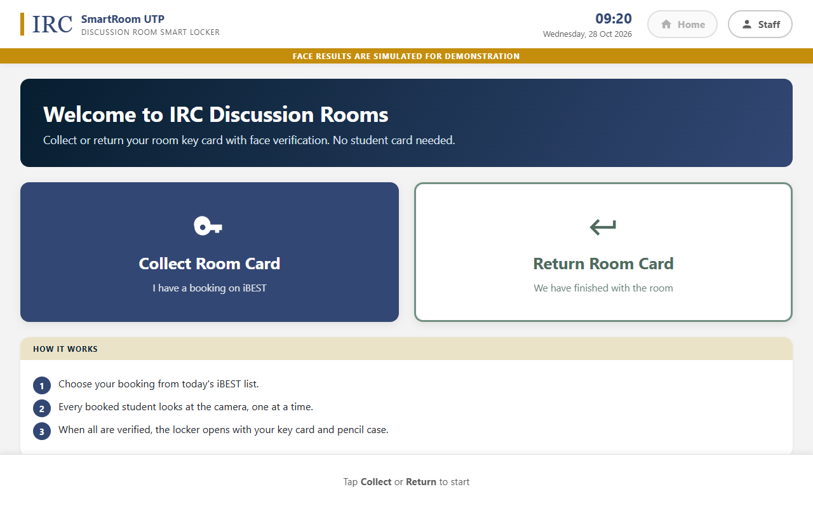
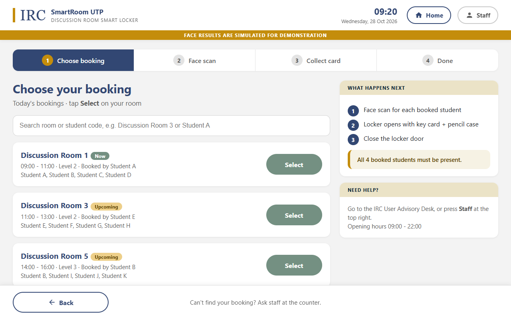
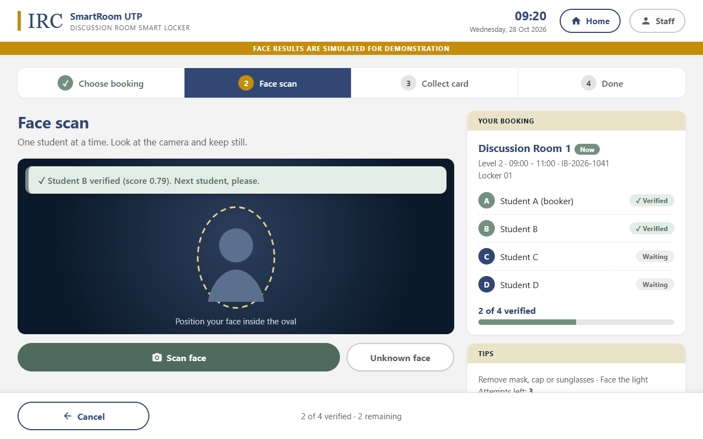
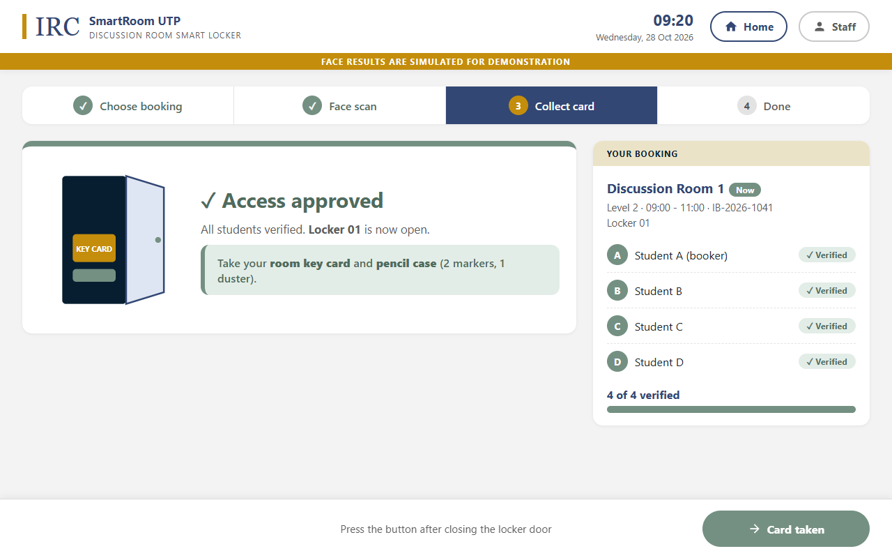
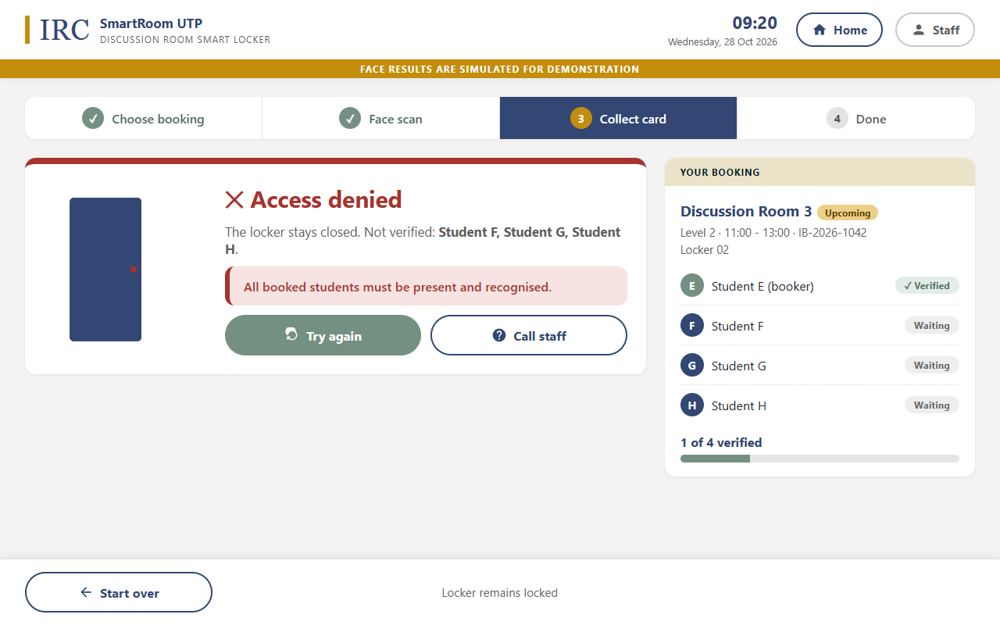
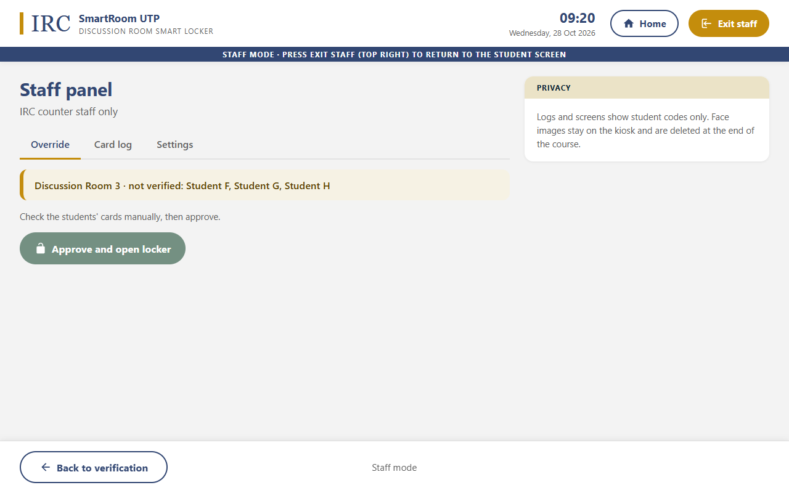

# SmartRoom UTP

AI-based smart locker for discussion-room access at the UTP Information Resource Centre (IRC).
Students verify their faces at the kiosk. When every booked student is recognised, the locker releases the room key card. Returning the card uses the same check.

TGB2013/TFB2073/TEB2023 Artificial Intelligence, Group 2.

## What is real, simulated and proposed

| Part | Status |
|---|---|
| Kiosk interface prototype (`prototype/index.html`), all screens and navigation | Real, clickable, face results simulated |
| Kiosk app wired to the face model (`app/kiosk.py`, Streamlit) | Real, for the camera stage |
| Face detection (YuNet) + face embeddings (SFace), pretrained, from OpenCV Zoo | Real |
| Matching only against the booked students, threshold, count each student once | Real (`src/matcher.py`) |
| Card log CSV with student codes | Real (`logs/card_log.csv`) |
| iBEST bookings | Simulated (`mock/bookings.json`) |
| Face results in screenshots | Simulated (simulation mode, no faces used) |
| Locker hardware (door unlock) | Proposed. Shown on screen only |
| Staff PIN | Mock value in `mock/config.json` |

## Open the prototype

Double-click `prototype/index.html`, or open it in any browser. No install or server is needed.
Staff PIN: `1234`. Add `?time=09:20` to the address to fix the clock.

## Run the camera version (later stage)

```bash
pip install -r requirements.txt
streamlit run app/kiosk.py
```

The face models (about 39 MB) download into `models/` on first real scan.

To use the real camera, open **Staff** (top-right), log in, and turn off **Simulation mode** in Settings.
The camera then compares each face with `data/gallery/<Student X>/*.jpg`.

## Data and evaluation

```bash
python -m src.prepare_data     # data/raw/<student>/*.jpg -> cropped, coded, split 70/15/15 by student
python -m src.evaluate         # chooses threshold on validation, reports FAR, FRR, accuracy, s/verification on test
```

`evaluate.py` saves the chosen threshold to `mock/config.json`, which the kiosk reads.

## Screenshots

Regenerate all 16 screens from the HTML prototype (1280 × 800, fixed 09:20 clock):

```bash
pip install playwright
python tools/capture_screens.py
```

Interface design, colours and navigation: [docs/ui_layout.md](docs/ui_layout.md).

| | |
|---|---|
|  |  |
|  |  |
|  |  |

## Repository layout

```
src/prepare_data.py   crop ID photos, rename to codes, split by student
src/face_model.py     pretrained detector + embedder
src/matcher.py        booking-only matching and verification session
src/evaluate.py       mock-booking evaluation, threshold selection
src/card_log.py       collect / return CSV log
prototype/index.html  clickable kiosk prototype (single HTML file)
app/kiosk.py          Streamlit kiosk with real camera + face model
mock/                 bookings.json, config.json
tools/                capture_screens.py
docs/                 ui_layout.md, screenshots/
```

## Privacy

- `data/`, `models/`, `logs/`, embeddings and model files are in `.gitignore`. Check `git status` before every push.
- Never commit face or ID images. Use student codes only in logs and screenshots.
- Keep the repository private. Delete all face data at the end of the course.
